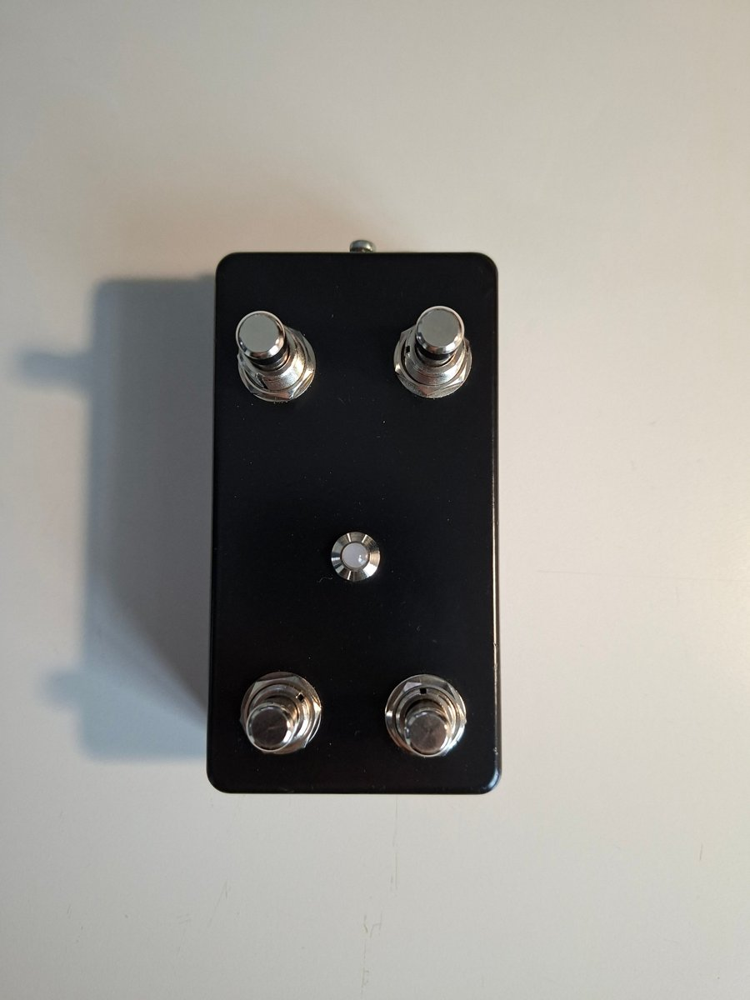
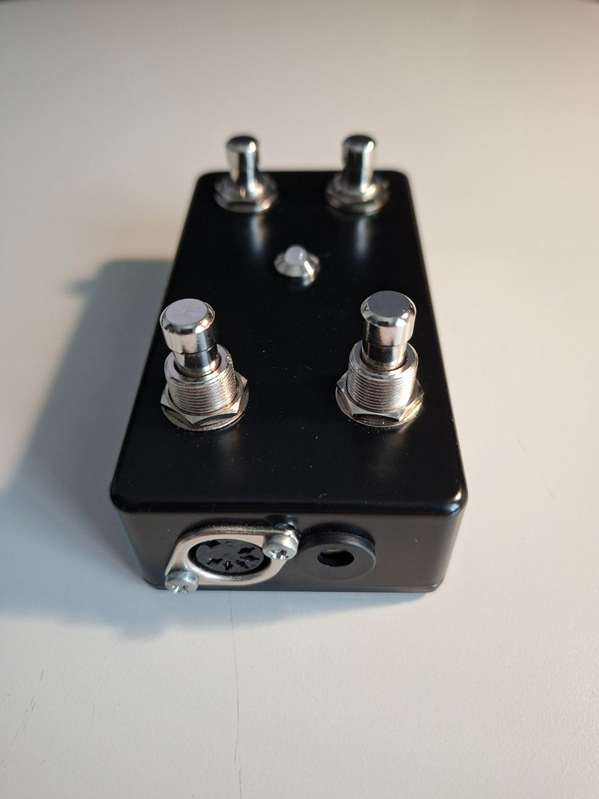
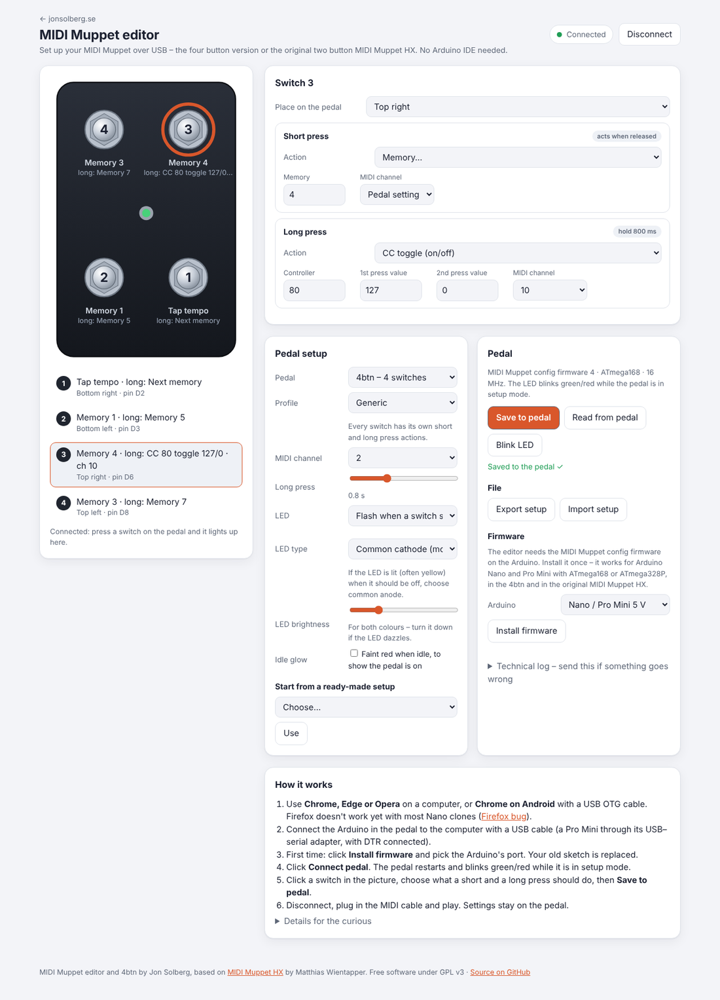
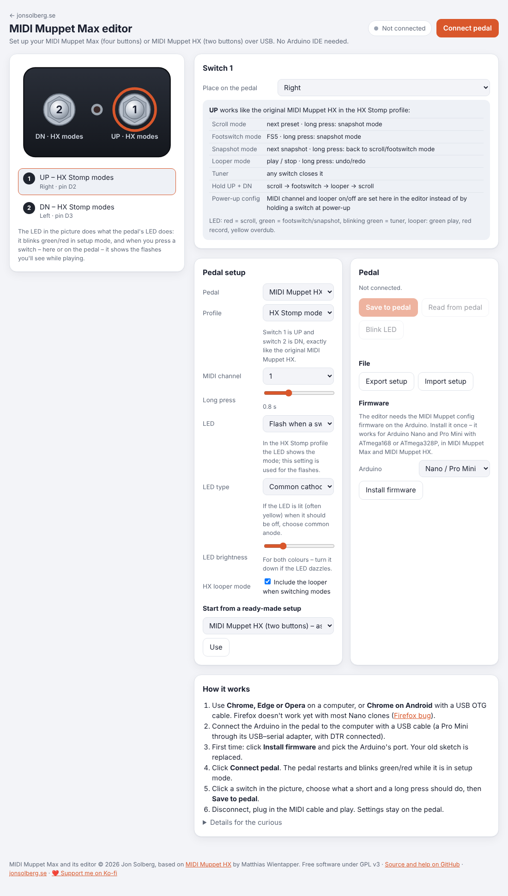

# MIDI Muppet Max

A four button Arduino MIDI foot switch that you set up from your browser. It controls the Line 6 HX Stomp,
the BOSS RC-500, the Wampler Terraform or any other MIDI device, and it is based on
[MIDI Muppet HX](https://github.com/mattzzw/midi_muppet_hx_2btn) by Matthias Wientapper.

**[Open the web editor](https://jonsolberg.se:8080/MidiMuppet/)**: install the firmware, choose what every
switch does and save it to the pedal over USB. No Arduino IDE needed. The editor also works with the
**original two button MIDI Muppet HX**.

<p>


</p>

## Web editor



### Getting started

1. Connect the Arduino in the pedal to the computer with a USB cable.
2. The first time: choose your Arduino (*Nano / Pro Mini 5 V* or *Pro Mini 3.3 V*), click **Install firmware**
   and pick the Arduino's port. The editor finds the bootloader (Nano with the old or new bootloader, or
   Pro Mini), checks the chip and installs the right firmware. A Pro Mini is programmed through its
   USB–serial adapter, with DTR connected so the editor can restart it.
3. Click **Connect pedal**. The pedal restarts and blinks green/red while it is in setup mode.
   Press a switch on the pedal and it lights up in the editor.
4. Click a switch in the picture and choose its short and long press actions, or start from a ready-made setup.
5. Click **Save to pedal**, disconnect and play. The settings are kept in the Arduino's EEPROM.

Setups can also be exported to a file and imported again.

### Browsers

- **Computer:** Chrome, Edge or Opera. The editor uses Web Serial to talk to the Arduino.
- **Android phone:** Chrome and a USB OTG cable. Web Serial on Android only lists Bluetooth devices, so the
  editor drives the USB chip itself through WebUSB (CH340, FTDI, CP210x and CDC-ACM boards).
- **Firefox** has Web Serial since version 151, but on Windows it can't yet receive data from boards with a
  CH340 USB chip (most Nano clones): the read stream ends at once, again and again
  ([Mozilla bug 2053974](https://bugzilla.mozilla.org/show_bug.cgi?id=2053974)). The editor tells you when that happens.

### What a switch can do

Each switch has a short press and a long press action:

- **Any MIDI device:** Program Change, Control Change, CC toggle (on/off), CC momentary (while held),
  next/previous program in a range, each on the pedal's MIDI channel or its own.
- **Line 6 HX Stomp:** tap tempo, tuner, preset and snapshot up/down, snapshot 1–8, FS1–FS5, all bypass,
  looper controls, footswitch mode.
- **BOSS RC-500:** memory 1–99, next/previous memory.
- **Wampler Terraform:** preset, next/previous preset.
- **HX Stomp profile:** switches 1 and 2 work exactly like the original MIDI Muppet HX (scroll, footswitch,
  snapshot, looper and tuner modes, hold both to change mode), and switches 3 and 4 get their own actions.

A switch without a long press action reacts as soon as you step on it. With a long press action, the short
press is sent when you lift your foot. The long press time and the MIDI channel are settings too.

### LED

The LED can flash when a switch sends, light only while a switch is held (green, then red once a long press
starts) or stay off, optionally with a faint red glow when idle to show the pedal is on. The brightness is
adjustable for both colours (green uses software PWM on Timer2). Common cathode and common anode bicolor LEDs
both work: if the LED is lit when it should be off, choose common anode.

### The original two button MIDI Muppet HX



Choose *Original HX – 2 switches* as the pedal, or the ready-made setup with the same name. UP (D2) and DN (D3)
work as in the original, and the MIDI channel and looper settings are set in the editor instead of by holding a
switch at power-up. The firmware is built for 16 MHz (Nano, Pro Mini 5 V) and 8 MHz (Pro Mini 3.3 V) boards.

## Hardware

Same build as the original MIDI Muppet HX, with two extra foot switches:

| Arduino pin | Connected to |
|---|---|
| D2, D3 | Foot switches 1 and 2 (HX: UP / DN), other leg to ground |
| D6, D8 | Foot switches 3 and 4 (HX: TAP / FOUR), other leg to ground |
| D4, D5 | Bicolor LED green / red via 220R, common pin to ground (common cathode) or 5V (common anode) |
| TX (D1) | MIDI pin 5 via 220R |
| 5V | MIDI pin 4 via 220R |
| VIN / RAW, GND | 9V power socket |

The switches use the Arduino's internal pull-ups, so they need no resistors. For a 3.3V Arduino, see the
resistor values in the [original build guide](https://github.com/mattzzw/midi_muppet_hx_2btn#building-midi-muppet-hx).

## Sketches

The web editor installs the universal firmware for you. The other sketches are fixed setups for one pedal each,
for those who prefer to change the code and upload it with the Arduino IDE.

| Sketch | Pedal | What it does |
|---|---|---|
| [`midi_muppet_4btn_config`](midi_muppet_4btn_config/midi_muppet_4btn_config.ino) | Any MIDI device | **Universal firmware for the web editor**, for the 4btn and the original 2 button MIDI Muppet HX |
| [`midi_muppet_hx_4btn`](midi_muppet_hx_4btn/midi_muppet_hx_4btn.ino) | Line 6 HX Stomp | Preset/snapshot scrolling, FS4/FS5, looper, tuner, tap tempo, all bypass |
| [`midi_Boss_RC500_4btn`](midi_Boss_RC500_4btn/midi_Boss_RC500_4btn.ino) | BOSS RC-500 Loop Station | Recalls 8 memories (short and long press) with Program Change |
| [`midi_Wampler_Terraform_4btn`](midi_Wampler_Terraform_4btn/midi_Wampler_Terraform_4btn.ino) | Wampler Terraform | Recalls 8 presets (short and long press) with Program Change |

### Building a sketch yourself

1. Install the libraries with the Arduino IDE library manager (the universal firmware needs none):
   [OneButton](https://github.com/mathertel/OneButton) (all other sketches) and
   [JC_Button](https://github.com/JChristensen/JC_Button) (HX Stomp sketch).
2. Open the sketch for your pedal.
3. Select your board, for example **Arduino Nano** with processor **ATmega168** (or ATmega328P).
4. Disconnect the MIDI cable while uploading, since MIDI uses the same TX pin as the USB upload.

All sketches build for both the ATmega168 and the ATmega328P.

### HX Stomp sketch

The UP/DN switches work like the original MIDI Muppet HX. TAP and FOUR are new:

| Switch | Click | Long press |
|---|---|---|
| UP | Next preset / snapshot, FS5, looper play/stop | Snapshot mode on/off, looper undo/redo |
| DN | Previous preset / snapshot, FS4, looper record/overdub | Tuner |
| TAP | Tap tempo | Tuner |
| FOUR | Toggles MIDI CC 6 (assign it to a block on the HX Stomp) | All bypass on/off |
| UP + DN | Cycle Scroll → FS → Looper mode | |

| Mode | LED |
|---|---|
| Scroll | red |
| FS / Snapshot | green |
| Tuner | blinking green |
| Looper | play: green, record: red, overdub: yellow |

Power-up settings, as in the original:

- **Hold DN while powering up** to set the MIDI channel (UP/DN changes it, hold both to exit).
- **Hold UP while powering up** to turn looper mode on (UP) or off (DN), hold both to exit.

### BOSS RC-500 and Wampler Terraform sketches

Each switch sends one Program Change on a short press and another on a long press. Change the `PROGRAMS`
table and `MIDI_CHANNEL` at the top of the sketch to pick your own presets. The LED flashes green for a short
press and red for a long press, and the number of flashes shows the preset's position in its bank of four.

Default mapping (PC 0 = preset 1):

| Switch | Short press | Long press |
|---|---|---|
| ONE (D2) | preset 2 | preset 6 |
| TWO (D3) | preset 1 | preset 5 |
| THREE (D6) | preset 4 | preset 8 |
| FOUR (D8) | preset 3 | preset 7 |

## For developers

### How the editor talks to the pedal

After power-up the universal firmware listens on USB at 115200 baud (57600 on 8 MHz boards) for 1.5 seconds.
If the editor says hello, it stays in setup mode. Otherwise it switches the serial port to MIDI speed (31250)
and works as a foot switch, so nothing is sent to your other pedals while it listens. The setup protocol is
plain text and is described at the top of the sketch.

### Tests

`tests/` runs the real compiled firmware in the [simavr](https://github.com/buserror/simavr) AVR simulator:

- `test_firmware.py` checks the setup protocol, every action type, short/long press timing, all
  HX Stomp modes, the two switch mode and the LED options on ATmega168 and ATmega328P, at 16 and 8 MHz.
- `e2e.js` opens the editor in headless Chrome with a simulated serial port (or, with `USB_CH340=1`, a
  simulated CH340 over WebUSB, as on Android) wired to the simulated pedal. It installs the firmware through
  the real ATmega168 Nano bootloader and the 3.3 V Pro Mini bootloader, then connects, edits, saves and checks
  the pedal's EEPROM and MIDI output.

```
tools/build_editor.py          # builds firmware/*.hex and editor/index.html
gcc -O2 -o tests/harness tests/harness.c -lsimavr -lelf
python3 tests/test_firmware.py
node tests/e2e.js <firmware.elf> atmega168 <ATmegaBOOT_168_diecimila.hex> nano168 16
SIM_MHZ=8 node tests/e2e.js <firmware.elf> atmega328p <ATmegaBOOT_168_atmega328_pro_8MHz.hex> promini 8
```

### Changes from the first version

The first version of this project was three separate sketches. Since then:


- Credit and the original BSD licence are in every sketch, not just the HX one.
- HX Stomp: long press on FOUR toggles all bypass (before, it could only bypass, never turn back on).
- HX Stomp: long press on TAP enters tuner mode properly, so the LED and the UP/DN switches
  know the tuner is on.
- HX Stomp: leaving the MIDI channel or looper settings returns to the mode you were in.
  Before, it fell back to scroll mode, and leaving the looper settings didn't save properly.
- HX Stomp: the tuner LED blinks steadily instead of flickering when the tuner is first opened.
- HX Stomp: MIDI CC numbers have names, and unused switches and libraries (`Wire.h`, extra
  JC_Button objects) are removed.
- RC-500 / Terraform: the two identical sketches are rewritten with a single settings table
  and shared click handlers instead of eight near-identical functions.
- Uses `setClickMs()` instead of the deprecated `setClickTicks()` in current OneButton.

## Credits

This project is built on **[MIDI Muppet HX](https://github.com/mattzzw/midi_muppet_hx_2btn)**
by **Matthias Wientapper**, a two button MIDI foot switch for the HX Stomp. The HX Stomp
sketch here is his code extended to four switches, and the other sketches reuse his MIDI
and LED code. Thank you, Matthias. His build guide, schematic and photos are well worth a
look if you want to build one yourself.

MIDI Muppet HX is licensed under the BSD 3-Clause License. Its copyright notice is kept in
every sketch and in [LICENSE-midi_muppet.txt](LICENSE-midi_muppet.txt).

## Support

The MIDI Muppet editor and firmware are free and open source. If you enjoy them, you can
[support me on Ko-fi](https://ko-fi.com/jonsolberg) ❤️

[](https://ko-fi.com/jonsolberg)

## License

Copyright © 2026 Jon Solberg

This program is free software: you can redistribute it and/or modify it under the terms of the
GNU General Public License as published by the Free Software Foundation, either version 3 of the
License, or (at your option) any later version.

This program is distributed in the hope that it will be useful, but WITHOUT ANY WARRANTY; without
even the implied warranty of MERCHANTABILITY or FITNESS FOR A PARTICULAR PURPOSE. See the
[GNU General Public License](LICENSE) for more details.

Code from MIDI Muppet HX is Copyright © 2020 Matthias Wientapper, used under the
[BSD 3-Clause License](LICENSE-midi_muppet.txt).
